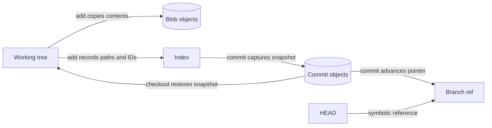

# MiniGit technical walkthrough

MiniGit implements the local version-control loop in Go. The React dashboard gives users another way to invoke the same operations and inspect their results. Start with the [README demo](README.md#try-it), then follow a file from the working tree to a commit.

## 1. Source map

| Area | Responsibility |
| --- | --- |
| [CLI](cmd/root.go) | Cobra commands resolve the repository from the working directory and call the core under a repository lock. |
| [Repository and refs](pkg/core/repo.go) | Discover and initialize `.mgit/`, validate paths, and coordinate CLI and dashboard access. [Branch logic](pkg/core/branch.go) |
| [Staging and objects](pkg/core/staging.go) | Stage files and deletions, compute status, and build commits. [Object format](pkg/core/object.go) |
| [Worktree transitions](pkg/core/worktree.go) | Preflight destinations, prepare replacement files, and roll back file changes on ordinary errors. |
| [Merge engine](pkg/core/merge.go) | Walk commit ancestry, select a merge base, and reconcile snapshots. |
| [HTTP API](pkg/api/server.go) | Serve the embedded frontend and expose repository operations on loopback. |
| [Dashboard](web/src/App.tsx) | Render working changes, branches, and history. Refresh after mutations and poll for CLI edits. |

## 2. Storage model

```text
.mgit/
├── HEAD                Current branch reference or detached commit ID
├── index               JSON map of staged path → blob ID
├── objects/
│   ├── <blob-id>       Raw file contents
│   └── <commit-id>     JSON snapshot and parent IDs
├── refs/
│   └── heads/
│       ├── main        Commit ID at the main branch tip
│       └── topic       Commit ID at the topic branch tip
└── MERGE_HEAD          Incoming parent and unresolved paths, present during conflict resolution
```

An initial `HEAD` contains `ref: refs/heads/main`. The branch ref appears with the first commit. A detached `HEAD` contains a full commit ID directly. Creating a branch writes another ref to the same commit and copies zero working files.

A blob ID comes from hashing the exact file bytes. Two paths containing the same bytes can refer to the same blob. Staging streams the bytes into a temporary object and computes the hash from that stream. When the object ID already exists, the writer checks for different content before reusing it.

A commit contains a message, timestamp, parent IDs, and a complete path-to-blob map. Its ID comes from hashing the canonical JSON with an empty ID field. The stored JSON includes the computed ID. Reading the commit verifies its identity and validates the snapshot and parent IDs. Worktree restores verify blob checksums before installing files. The SHA-1 IDs preserve the original MiniGit format. SHA-1 is collision-prone, so treat the IDs as local storage identifiers and checksums.



## 3. Status, staging, and commits

Think of one file as having up to three versions. Status compares **HEAD to the index** for staged changes and **the index to the working tree** for modified files. A regular file present only in the working tree is untracked. Missing tracked paths count as changes too.

| Scenario | Status |
| --- | --- |
| Edit and stage `notes.md` | Staged |
| Edit it again after staging | Staged and modified |
| Delete a tracked file | Modified until staged |
| Stage that deletion | Staged |
| Create a regular file | Untracked until staged |

Suppose `notes.md` contains `A` in HEAD. Edit it to `B`, stage it, then edit it to `C`. A commit captures `B` because commit reads the index. `C` remains a working-tree edit. To stage a deletion, use `mgit add notes.md` even when the path is missing, or use `mgit add .` from the repository root. Committing the last deletion creates a valid empty snapshot. A regular commit with an unchanged index returns an error.

CLI paths are relative to the invoking directory. API paths are relative to the repository root even when `mgit ui` was launched from a nested directory. Both use one index write for a staging batch. An aborted batch can leave harmless, unreferenced blob objects.

## 4. Checkout and reset

Checkout first resolves the target as a branch or a full commit ID, then checks tracked working and staged changes. The worktree updater checks every affected path and refuses to overwrite untracked files. It also checks parent directories when transitioning between a file and a directory at the same path. An unaffected untracked file stays in place.

The updater prepares and checksums all incoming blobs before changing the tree. It moves affected files into a temporary backup directory, installs the replacements, writes the new index, then updates the ref or HEAD. On ordinary errors it attempts to restore the original files and index. If rollback itself fails, the error identifies the directory containing surviving backups. Its `original/` subdirectory keeps their repository-relative paths.

| Reset mode | Moves HEAD | Replaces index | Restores tracked files |
| --- | --- | --- | --- |
| Soft | Yes | | |
| Mixed, the default | Yes | Yes | |
| Hard | Yes | Yes | Yes |

A hard reset also removes files that exist only in the index if they are absent from the target. It preserves unrelated untracked files and refuses untracked collisions. During a conflicted merge, `mgit reset --hard <current-commit-id>` abandons the merge and restores the tracked snapshot.

## 5. Three-way merge

Commits form a directed acyclic graph. A normal commit has one parent, the initial commit has none, and a merge commit has two. For example, both tips below descend from `A`.

```text
A ── B ── D   main
 ╲
  C ── E      topic
```

MiniGit walks parent links from both tips. If the incoming branch is already reachable from HEAD, the merge is up to date. If HEAD is reachable from the incoming tip, the merge fast-forwards to that tip. For diverged histories, MiniGit removes superseded common ancestors and uses the single remaining merge base. It reports an error for histories with zero or multiple best bases.

For each path in the three snapshots, compare the blob IDs. A missing path acts as a distinct value, which makes deletion part of the same logic.

| Rule | Outcome |
| --- | --- |
| Both tips agree | Keep their shared value. |
| Only the incoming tip differs from the base | Take the incoming change. |
| Only HEAD differs from the base | Keep HEAD’s change. |
| Both tips differ from the base and each other | Mark a file-level conflict. |

After a clean merge, the new snapshot has the current tip as its first parent and the incoming tip as its second. The CLI log and dashboard follow first parents to show the current line of development.

For text conflicts, MiniGit writes `<<<<<<< HEAD`, `=======`, and `>>>>>>>` markers. For binary conflicts, it keeps the current version where one exists, otherwise it keeps the incoming version. In both cases, the merge state records the unresolved path. Choose the correct contents in an editor or delete the file, then stage that path and commit. An unchanged generated marker file is rejected. Checkout and further merges stop while resolution is in progress.

## 6. Local dashboard and security

`go build -tags ui -o mgit .` embeds the Vite bundle from `web/dist/` using `go:embed`. At runtime the executable serves the application and JSON API at `127.0.0.1`. The default Go build supports CLI workflows without a prior Node build.

The dashboard calls `GET /api/overview` every three seconds when idle. It loads status, branches, and history together under the same lock, then refreshes after a mutation. Older responses cannot replace a newer view. The working-tree panel supports per-file staging and stage-all. Search matches commit messages and ID prefixes within the visible first-parent history.

| Endpoint | Purpose |
| --- | --- |
| `GET /api/overview` | Repository name, status, branches, and history in one response. |
| `GET /api/status`, `/api/branch`, `/api/log` | Individual read endpoints. |
| `POST /api/add`, `/api/commit` | Stage paths or commit the index. |
| `POST /api/branch`, `/api/checkout`, `/api/merge`, `/api/reset` | Branch and history operations. |

The listener is local, the HTTP handler checks the host and browser origin, and mutations accept bounded JSON bodies. The core validates stored paths and object IDs, uses repository-rooted filesystem operations, and rejects symlinks when staging or rewriting files. The CLI and API take the same `.mgit/operation.lock` while operating. Normal exits release it. If a process is killed and leaves the lock directory, close any running MiniGit commands and inspect `.mgit/` for worktree backups before removing the stale lock.

## 7. Scope and tradeoffs

- **Snapshot cost.** Each commit keeps a full path-to-blob map, so commit metadata grows with tracked file count. Identical file contents share an object. Status walks the working tree and hashes tracked files, and history reads commit objects on demand.
- **Merge granularity.** Conflict detection is at file level. Independent edits to separate lines in the same file still require a manual resolution. File/directory conflicts that would create an invalid snapshot and histories with multiple best bases are rejected.
- **Local file format.** The format covers regular files and their contents. It omits remote transport, Git interoperability, rename detection, permission tracking, and a repository-level ignore engine. The source repository’s `.gitignore` is used by Git.
- **Recovery.** Atomic file replacement and rollback cover ordinary filesystem errors. Power loss, forced termination, concurrent edits by external programs, and failed rollback can require manual recovery. Older ordinary MiniGit repositories can retain their SHA-1 objects and refs.

## 8. Interview preparation

| Interview question | What to explain |
| --- | --- |
| What does `add` do that `commit` does differently? | Walk through the `A → B → C` example. Explain why capturing bytes at stage time matters. |
| How does deduplication work? | Separate the path recorded in the snapshot from the raw bytes addressed by the blob ID. |
| What makes history a graph? | Draw two divergent branches and explain why a merge commit stores both parents while the history view follows the first. |
| How does a deletion survive a merge? | Compare a missing blob ID with the base value. Show how the worktree updater removes the tracked file. |
| How do you prevent checkout from losing data? | Describe dirty-tree checks, untracked collision checks, preflight blob verification, and rollback. |
| How would you support large repositories? | Discuss efficient directory trees, incremental status, and on-demand history pagination. Tie the proposal to the current cost of full snapshots and working-tree scans. |

To demonstrate the hard case, create two branches from one commit, edit the same file differently on each, then merge. Show the conflict, check that commit is blocked, resolve and stage the file, and run `mgit log`. The resulting commit object in `.mgit/objects/` records both parents.
