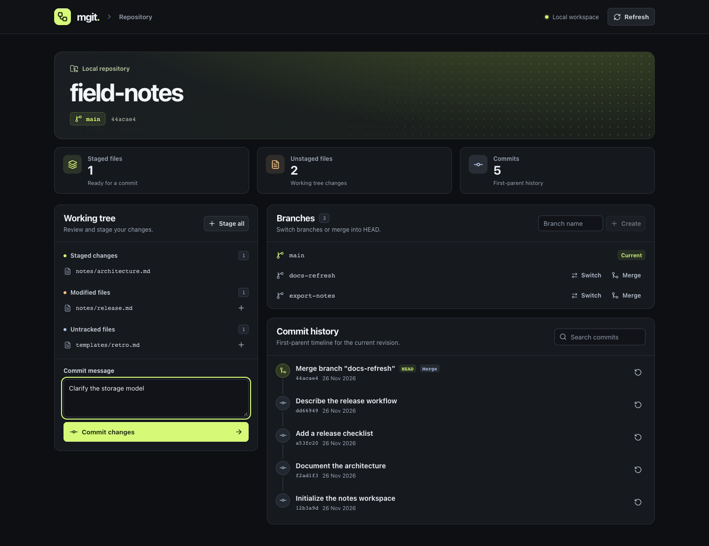

# MiniGit

Track changes in your own folders with Git-style commands or a browser dashboard. Both use the same local history.



## Build once

If you already built MiniGit, skip to [Track your folder](#track-your-folder). To build it, you’ll need Go 1.26.11+ and Node.js 24+.

```sh
cd ~/Desktop/minigit
(cd web && npm ci && npm run build)
go build -tags ui -o mgit .
```

These examples assume MiniGit is in `~/Desktop/minigit`. Use the path to your copy if you saved it elsewhere.

## Track your folder

In Terminal, replace `/path/to/your/folder` with the folder you want to track.

```sh
cd "/path/to/your/folder"
~/Desktop/minigit/mgit init
~/Desktop/minigit/mgit add .
~/Desktop/minigit/mgit commit -m "First commit"
```

Run `init` once per folder. After editing files, repeat the `add` and `commit` commands. To stage a specific file or subfolder, replace `.` with its path.

## Open the dashboard

From the folder you’re tracking, run `~/Desktop/minigit/mgit ui` and open [http://127.0.0.1:8080](http://127.0.0.1:8080). You can stage files, commit, switch branches, and view the same history from your browser. Press **Ctrl+C** in Terminal to stop the dashboard and return to the command prompt.

## Branches and history

| Command | Action |
| --- | --- |
| `~/Desktop/minigit/mgit status` | See staged and unstaged changes |
| `~/Desktop/minigit/mgit log` | View commit history |
| `~/Desktop/minigit/mgit branch experiment` | Create a branch after your first commit |
| `~/Desktop/minigit/mgit checkout experiment` | Switch to that branch |
| `~/Desktop/minigit/mgit checkout main` | Switch back to the main branch |
| `~/Desktop/minigit/mgit merge experiment` | Merge the experiment branch into the current branch |

MiniGit uses Go for content-addressed storage, snapshots, and three-way merges. The React dashboard is bundled into the executable. [Technical walkthrough](PROJECT_DOCUMENTATION.md) · [Automated checks](.github/workflows/ci.yml)
